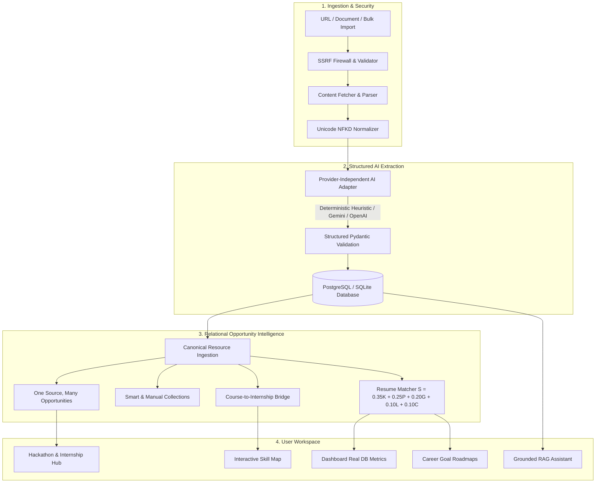

<div align="center">

# 🧠 LinkMind AI

### Personal Learning, Internship & Career Opportunity Intelligence Platform

[](https://python.org)
[](https://fastapi.tiangolo.com)
[](https://react.dev)
[](https://www.typescriptlang.org)
[](https://tailwindcss.com)
[](https://vitejs.dev)
[](https://www.docker.com)
[](LICENSE)

<p align="center">
  <b>Turn scattered bookmarks, LinkedIn posts, PDFs, and course links into an organized, profile-aware opportunity workspace.</b>
</p>

</div>

---

## 💡 The Problem & The Solution

**The Problem**:
You save hundreds or thousands of useful links from LinkedIn, Google Docs, course sites, and internship portals. Later, you can't remember what was in them, which ones are worth your time, what their deadlines are, or how they connect to your career goals.

**The Solution**:
**LinkMind AI** transforms scattered URLs and documents into a structured, searchable, personalized opportunity library:
- **One Source, Multiple Opportunities**: Paste a LinkedIn post containing 10 internship openings or hackathons — LinkMind creates a single source record and extracts 10 distinct, individually validated opportunities.
- **Canonical Records & Multi-Category Folders**: An opportunity can belong to *AI & Machine Learning*, *Core Software Engineering*, and *Hackathons* without duplicating database records.
- **Resume Intelligence & Transparent Scoring**: Evaluates each opening against your actual resume and projects using a transparent weighted formula ($S = 0.35K + 0.25P + 0.20G + 0.10L + 0.10C$), explaining *why* it fits and *what skills you're missing*.
- **Course-to-Opportunity Mapping**: Connects saved courses directly to internships and hackathons that require those exact skills.
- **Zero Hallucination Policy**: Unknown facts (missing deadlines, unstated salaries) remain `null` or "Needs verification" — never fabricated.
- **Clean Starting State**: Starts with an empty personal library; all dashboard counters are real database queries.

---

## 🏛️ System Architecture



---

## ✨ Key Features

### 1. 📥 Universal Link & Document Inbox
- Paste links from LinkedIn, course websites, company job portals, Devpost, GitHub, and YouTube.
- Upload documents (**PDF**, **DOCX**, **TXT**, **MD**).
- Bulk URL import with background batch processing.
- Handles LinkedIn Mathematical Bold Unicode styling (e.g. `𝗗𝗲𝘃𝗲𝗹𝗼𝗽𝗲𝗿 𝗛𝗮𝗰𝗸𝗮𝘁𝗵𝗼𝗻` $\rightarrow$ `Developer Hackathon`).

### 2. 🎯 Transparent Resume Recommendation Formula
LinkMind uses an explainable formula instead of black-box LLM scoring:
$$\mathcal{S} = 0.35K + 0.25P + 0.20G + 0.10L + 0.10C$$
- **$K$ (35%)**: Required skill alignment against verified competencies.
- **$P$ (25%)**: Relevance of past portfolio projects and practical experience.
- **$G$ (20%)**: Alignment with target career roles and long-term goals.
- **$L$ (10%)**: Learning value and skill-gap closure.
- **$C$ (10%)**: Practical fit (location preferences, remote suitability, compensation).
- **Hard Eligibility Checks**: Graduation year, degree, and authorization are evaluated independently from the fit score.

### 3. 🏆 First-Class Hackathon & Competition Hub (`/hackathons`)
- Dedicated view for hackathons and bounties.
- Extracts prize pools, registration deadlines, themes, and required technical stacks.
- Matches hackathon project requirements directly to your verified skills.

### 4. 🗺️ Course-to-Internship Relationship Engine
- Automatically connects:
  - `Course` teaches skill $\rightarrow$ `Internship` requires skill $\rightarrow$ `Course prepares for Internship`.
  - Discovers duplicate listings and shared prerequisite skill stacks.

### 5. 🧩 Interactive Skill Map & Role Gap Analyzer (`/skills`)
- Benchmark skills against target industry roles (*AI Engineer*, *Backend Developer*, *Full Stack*, *Data Scientist*).
- Displays possessed skills vs missing skills alongside saved courses that bridge those exact gaps.

### 6. 🛣️ Personalized Career Roadmaps (`/roadmaps`)
- Dynamically generates custom execution roadmaps for any goal (e.g. *AI/ML Engineer Internship*).
- Integrates saved courses, project milestones, and shortlisted applications with interactive step tracking.

### 7. 🤖 Grounded Conversational AI Assistant (`/assistant`)
- Queries your saved library with strict grounding.
- Answers questions like *"Which AI internships best match my resume?"* or *"Which courses should I take before applying?"* with clickable citations to your saved records.

### 8. 📋 Application Pipeline (`/applications`)
- Track opportunities across stages: `Saved`, `Shortlisted`, `Preparing`, `Applied`, `Assessment`, `Interview`, `Offer`, `Rejected`.
- Visibility into deadlines and notes.

### 9. 🔐 Login & Google Authenticator (TOTP 2FA)
- Dedicated modern sign-in / registration portal with 1-click Demo Workspace access.
- Time-based One-Time Password (TOTP) two-factor authentication compatible with **Google Authenticator** on Android & iOS.
- In-app QR code generation, manual secret backup keys, and immediate verification challenge upon login.
- Security management directly available in **Settings** and **Profile**.

---

## 🗂️ Application Routes

| Route | View | Description |
|---|---|---|
| `/login` | **Authentication Portal** | Secure login, registration, and Google Authenticator 2FA challenge screen |
| `/dashboard` | **Workspace Overview** | Real library metrics, Quick Capture bar, subject folders, and top matches |
| `/inbox` | **Universal Inbox** | Ingest links and documents; inspect provenance and parsing logs |
| `/resources` | **All Resources** | Filterable, searchable opportunity catalog |
| `/courses` | **Course Library** | Searchable learning resources with taught skills and syllabus links |
| `/internships` | **Internship Manager** | Vacancy tracker with fit score breakdowns, locations, and deadlines |
| `/hackathons` | **Hackathons & Bounties**| Competitions with prize pools, themes, and registration dates |
| `/collections` | **Collections Hub** | Automatic subject folders and user-created folders without duplicate rows |
| `/collections/:id` | **Collection Detail** | Single folder contents and folder management |
| `/resources/:id` | **Opportunity Inspector** | Full opportunity audit, match score breakdown, and notes |
| `/skills` | **Skill Map** | Gap analysis connecting missing skills to saved courses |
| `/roadmaps` | **Career Roadmaps** | Grounded step-by-step career action plans |
| `/applications` | **Application Pipeline** | Stage tracking from application to interview and offer |
| `/assistant` | **AI Assistant** | Grounded conversational assistant with citations |
| `/profile` | **Resume & Preferences** | Resume upload (PDF/DOCX), parsed skills inspection, and target roles |
| `/settings` | **Settings & Export** | One-click full JSON export (GDPR), dark/light theme switch, account deletion |

---

## 💻 Tech Stack

| Component | Technology | Rationale |
|---|---|---|
| **Frontend** | React 18, TypeScript, Vite | Fast HMR, type safety, maintainable architecture |
| **Styling** | Tailwind CSS | Consistent neutral theme with light & dark modes |
| **State & Cache** | TanStack React Query v5 | Efficient server-state synchronization and cache invalidation |
| **Icons** | Lucide React | Clean, modern iconography |
| **Backend** | Python 3.12, FastAPI | High-performance asynchronous API framework |
| **ORM & Schema** | SQLAlchemy 2.0, Alembic | Safe declarative relations and reliable migrations |
| **Database** | SQLite (dev) / PostgreSQL (prod) | Relational integrity, foreign keys, cascade safety |
| **Document Parsing** | PyMuPDF (`fitz`), `python-docx` | Native text extraction from PDFs and Word documents |
| **Web Fetching** | `httpx`, `BeautifulSoup4` | Async HTTP client with SSRF firewall and HTML cleaning |
| **AI Processing** | Modular Provider Adapter | Supports Gemini, OpenAI, or intelligent offline heuristic fallback |

---

## 🔒 Security & Safety Architecture

- **SSRF Hardening**: All fetched URLs undergo DNS resolution and IP verification to block loopback (`127.0.0.1`, `localhost`), private networks (RFC 1918), link-local addresses, and cloud metadata (`169.254.169.254`).
- **Prompt Injection Defense**: Scraped external web content is quarantined as untrusted data and strictly prevented from acting as AI instructions.
- **Multi-Tenant Data Isolation**: Every resource query is scoped by authenticated user ID.
- **Data Portability**: Full JSON export and account deletion available in Settings.

---

## ⚡ Quickstart Guide

### Prerequisites
- **Python 3.10+** (Python 3.12 recommended)
- **Node.js 18+** & **npm**

---

### Method 1: Local Development

#### 1. Clone the repository
```bash
git clone https://github.com/your-username/linkmind-ai.git
cd linkmind-ai
```

#### 2. Backend Setup
```bash
# Navigate to backend and create virtual environment
cd backend
python -m venv venv

# Activate virtual environment
# Windows (PowerShell):
venv\Scripts\activate
# Linux / macOS:
source venv/bin/activate

# Install backend dependencies
pip install -r requirements.txt

# Run database migrations
alembic upgrade head

# Start FastAPI server on port 8000
uvicorn app.main:app --reload --port 8000
```
> The API will be live at `http://localhost:8000`. Interactive OpenAPI documentation is accessible at `http://localhost:8000/docs`.

#### 3. Frontend Setup
```bash
# Open a new terminal and navigate to frontend
cd frontend

# Install frontend dependencies
npm install

# Start Vite dev server on port 5173
npm run dev
```
> Open `http://localhost:5173` in your browser.

---

### Method 2: Docker Compose

Run the entire application (Frontend + Backend + PostgreSQL) with a single command:
```bash
docker compose up --build
```
> The application will be accessible at `http://localhost:8000`.

---

## 🧪 Testing & Acceptance Criteria

LinkMind AI includes a comprehensive automated test suite verifying edge cases, SSRF defense, idempotency, and recommendation formulas.

```bash
# Run pytest from the repository root:
# Windows (PowerShell):
$env:PYTHONPATH="backend"
backend\venv\Scripts\pytest backend\tests -v

# Linux / macOS:
PYTHONPATH=backend pytest backend\tests -v
```

### Verified Test Cases:
1. `test_empty_library_initial_state`: Database starts completely empty with zero fake dashboard data.
2. `test_ssrf_protection_blocks_restricted_destinations`: Rejects `127.0.0.1`, `localhost`, `169.254.169.254`, `10.0.0.1`, and private IP subnets.
3. `test_one_source_many_opportunities_extraction`: Splits a post with 3-10 opportunities into 3-10 separate canonical records.
4. `test_hackathon_extraction_and_stats`: Automatically extracts Devpost/MLH hackathons with prize pools, deadlines, and dashboard counting.
5. `test_missing_facts_not_invented`: Missing deadlines or salaries stay `None`, never fabricated.
6. `test_collection_creation_and_resource_association`: One resource belongs to multiple folders; deleting a collection preserves underlying resources.
7. `test_application_status_persistence`: Status updates (e.g. from Saved to Applied or Interview) persist across sessions.
8. `test_resume_update_recalculates_recommendations`: Updating user skills dynamically updates match scores via the weighted formula.
9. `test_user_data_isolation`: User B cannot access or modify User A's private resources.

---

## 📁 Repository Structure

```
linkmind-ai/
├── backend/
│   ├── alembic/              # Database schema migrations
│   ├── app/
│   │   ├── api/              # REST route controllers (v1)
│   │   │   └── v1/           # Auth, sources, resources, collections, hackathons, roadmaps...
│   │   ├── core/             # Configuration, SSRF firewall, DB engine, JWT security
│   │   ├── models/           # SQLAlchemy 2.0 relational models
│   │   ├── schemas/          # Pydantic v2 schemas
│   │   ├── services/         # Extractor, AI adapter, matcher, relationship engine, assistant
│   │   └── main.py           # FastAPI application entrypoint
│   ├── tests/                # Automated pytest test suites
│   ├── requirements.txt      # Python dependencies
│   └── alembic.ini           # Alembic migration configuration
├── frontend/
│   ├── src/
│   │   ├── components/       # Sidebar, Header, ResourceCard, CaptureModal, EmptyState
│   │   ├── context/          # ThemeProvider (Dark / Light mode)
│   │   ├── pages/            # Dashboard, Inbox, Resources, Courses, Internships, Hackathons...
│   │   ├── services/         # Typed API client
│   │   ├── types/            # TypeScript interfaces
│   │   ├── App.tsx           # Router and application layout
│   │   └── main.tsx          # Frontend entrypoint
│   ├── package.json          # Node dependencies
│   ├── tailwind.config.js    # Tailwind configuration
│   └── vite.config.ts        # Vite build configuration
├── .env.example              # Environment variable template
├── .gitignore                # Comprehensive Git ignore rules
├── Dockerfile                # Multi-stage production container
├── docker-compose.yml        # Docker compose configuration (App + PostgreSQL)
└── README.md                 # Project documentation
```

---

## 🤝 Contributing

1. Fork the Project
2. Create your Feature Branch (`git checkout -b feature/AmazingFeature`)
3. Commit your Changes (`git commit -m 'Add some AmazingFeature'`)
4. Push to the Branch (`git push origin feature/AmazingFeature`)
5. Open a Pull Request

---

## 📄 License

Distributed under the MIT License. See `LICENSE` for more information.

---

<div align="center">
  <b>Built for students, engineers, and lifelong learners navigating modern opportunities.</b>
</div>
